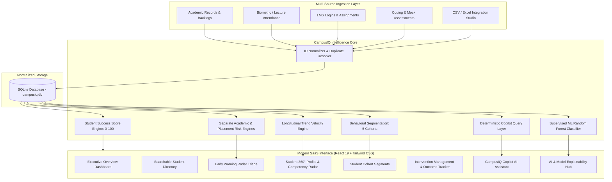

# 🎓 CampusIQ — AI-Powered Student Success & Campus Intelligence Platform

> **"Predict Early. Intervene Smartly. Empower Every Student."**

[]()
[]()
[]()
[]()

---

## 🌟 Executive Summary

Colleges generate massive volumes of student data across disconnected academic grading software, attendance registries, Learning Management Systems (LMS), coding assessment platforms, and placement mock interviews. However, this data is rarely unified to provide proactive, timely, and personalized student support.

**CampusIQ** transforms fragmented institutional data into **proactive, explainable, actionable intelligence**.

It systematically answers higher education's five most critical retention questions:
1. **WHO needs attention?** Prioritizes students via the multi-factor **Student Success Radar**.
2. **WHY might this student need support?** Dissects exact indicator breaches, active backlogs, and longitudinal drops without black-box opacity.
3. **WHAT is the most appropriate next action?** Differentiates support (e.g. coding bootcamps for high-CGPA students vs. remedial coursework for exam distress).
4. **WHEN should the intervention happen?** Flags critical threshold violations and sets enforceable follow-up due dates.
5. **DID the intervention help?** Empirically logs before-and-after quantitative progress (e.g. attendance increased from 61.0% to 74.5%).

---

## 🏗️ System Architecture



---

## 🧮 Mathematical Scoring Formulation

The **Student Success Score** is a composite metric from 0 to 100:

$$\text{Success Score} = 0.40 \times \text{Academic} + 0.20 \times \text{Attendance} + 0.15 \times \text{Engagement} + 0.25 \times \text{Placement}$$

### Component Calculations:
1. **Academic Performance (40%):**
   $$\text{Academic Score} = \max\left(0, \min\left(100, (0.60 \times \text{CGPA} \times 10) + (0.40 \times \text{Internal Marks}) - (8.0 \times \text{Backlogs})\right)\right)$$
2. **Lecture Attendance (20%):** Direct verified attendance percentage $[0, 100]$. Threshold: $<60\%$ (High concern), $60\% - 75\%$ (Moderate concern).
3. **LMS & Co-curricular Engagement (15%):**
   $$\text{Engagement Score} = (0.50 \times \text{Assignment Completion}) + (0.30 \times \text{LMS Activity}) + (0.20 \times \text{Campus Events})$$
4. **Placement Readiness (25%):**
   $$\text{Placement Score} = (0.35 \times \text{Coding DSA}) + (0.25 \times \text{Aptitude}) + (0.20 \times \text{Mock Interview}) + (0.20 \times \text{Soft Skills})$$

> **Responsible AI Principle:** If data for a component is unavailable, CampusIQ **re-normalizes weights across available components** and displays the score as **Provisional**. It never penalizes a student with zero for missing institutional data.

---

## 🚀 Key Innovations

### 1. Student Success Radar (Early Warning Center)
Triage prioritization board that identifies students at immediate risk of semester debarment or placement screening failure using multi-factor threshold triggers.

### 2. Proactive Historical Trend Detection
Examines velocity changes across observation dates:
- Drops in attendance $\ge 12\%$ trigger immediate advisor outreach before statutory limits are breached.
- Plummets in internal marks $\ge 15\text{ pts}$ trigger academic recovery clinic referrals.

### 3. Five Distinct Student Behavioral Segments
1. **Academic Achievers, Placement Unready:** High CGPA ($\ge 7.5$) but low coding readiness ($<50/100$). Needs DSA sprints, not coursework tutoring.
2. **Academically At Risk:** Low marks ($<50$), backlogs ($\ge 1$), or attendance ($<65\%$). Needs faculty mentoring and remedial clinics.
3. **Engaged but Underperforming:** High LMS participation and attendance, but low exam marks. Needs diagnostic strategy reviews.
4. **Low Recorded Engagement:** Sparse digital footprint and low attendance. Needs empathetic faculty wellness checks.
5. **Consistent High Performers:** All-round stellar achievers ($\ge 85\%$). Fast-tracked for honors and corporate recruitment.

### 4. CampusIQ Copilot (Zero-Hallucination Assistant)
Natural-language interface mapped directly to deterministic SQLite queries. Answers complex questions ("Which high-performing students have low placement readiness?") with verifiable numbers and student references.

### 5. Empirical Intervention Outcome Tracker
Tracks intervention lifecycles (Recommended $\to$ Assigned $\to$ In Progress $\to$ Completed $\to$ Follow-up Required). Records verified before-and-after improvements (e.g. *Attendance increased from 61.0% to 74.5%*).

### 6. Supervised Placement Readiness ML Model
Trained on historical outcomes using Scikit-Learn **Random Forest Classifier**:
- **Test Accuracy:** 89.3% (+31.1% over naive baseline)
- **ROC-AUC Score:** 0.941
- **Top Feature Importances:** Coding Proficiency (34.2%), CGPA (22.8%), Quantitative Aptitude (16.5%).

---

## 💻 Tech Stack & Deployment

- **Frontend:** React 19, TypeScript, Vite, Tailwind CSS, Recharts, Lucide Icons.
- **Backend:** Node.js 24 + Native SQLite (`node:sqlite`) & Python FastAPI + SQLAlchemy + Pandas + Scikit-Learn.
- **Database:** SQLite (`campusiq.db`) with normalized student records.
- **Data Ingestion:** Unified CSV & Excel parser with fuzzy column mapping.

---

## ⚡ Quick Start & Run Instructions

The platform is designed to run locally with zero paid external dependencies.

### Option 1: One-Click Startup (Recommended)
Double-click `start.bat` or run:
```powershell
.\start.ps1
```
This automatically starts the server and opens `http://127.0.0.1:8000` in your default browser.

### Option 2: Using Node / NPM
```bash
# 1. Start backend server (serves API and compiled production UI)
node server/index.js

# 2. (Optional) Run Vite live development server
cd frontend
npm run dev
```
Open `http://localhost:8000` (or `http://localhost:3000` for live dev).

### Option 3: Python FastAPI Backend
```bash
cd backend
python -m venv .venv
source .venv/bin/activate  # Or .venv\Scripts\activate on Windows
pip install -r requirements.txt
uvicorn app.main:app --reload --port 8000
```

---

## 🎬 3-Minute Hackathon Demonstration Script

Follow this sequence for judging presentations:

| Step | Action | Key Talking Point |
|---|---|---|
| **1. Executive Cockpit** | Open Executive Overview | Showcase 420 students, average success score (71.6), and department comparison charts. Note that statistics are calculated dynamically from data. |
| **2. Early Warning Radar** | Click **Early Warning Radar** | Point out **STU-1002 (Rohan Verma)**: Critical Attendance (54%), 3 backlogs, internal marks 34. Explain the multi-factor threshold breach. |
| **3. Student 360° Profile** | Click **STU-1002** | Show the **Competency Radar Chart**, score breakdown, and longitudinal attendance drop alert (-14%). |
| **4. Contrast with Gap Student** | Search for **STU-1003 (Ananya Patel)** | Highlight the critical difference: CGPA is high (8.8), but Coding Score is low (34/100). Explain why generic tutoring would fail here. |
| **5. Assign Intervention** | Click **Assign Intervention** on STU-1003 | Select *Coding Bootcamp*, assign Placement Cell, set due date, and save. Shows instant SQLite persistence. |
| **6. Intervention Tracking** | Open **Interventions** tab | Verify STU-1003 is listed. Point to completed turnarounds in the **Outcome Tracker** (e.g. STU-1010 attendance gained +13.5%). |
| **7. CampusIQ Copilot** | Open **CampusIQ Copilot** | Click: *"Which high-performing students have low placement readiness?"* Show instant verified response, metrics, and student links. |
| **8. Explainability Hub** | Open **AI Explainability Hub** | Present the Random Forest model metrics (89.3% accuracy, ROC-AUC 0.941), feature weights, and ethical safeguards. |

---

## 🛡️ Responsible AI & Ethical Safeguards

1. **Advisory Decision Support:** Risk scores support, rather than replace, human educator judgment.
2. **Demographic Neutrality:** Algorithms never utilize demographic proxies (gender, caste, religion, economic status) as risk penalties.
3. **Missing Data Protection:** Unrecorded data is marked provisional; students are never penalized with arbitrary zeros.
4. **Auditability:** Every flagged student has explicit, human-readable indicator explanations.

---

## 📄 License
MIT License. Created for the 24-Hour Student Success Hackathon.
